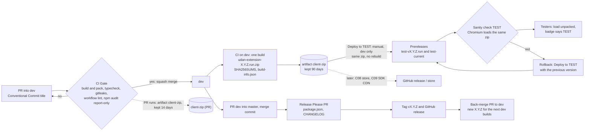

# Digital Assistant Client (UDAN)

Browser extension UI for the Universal Digital Assistant Network. The core logic comes from the published SDK, `@udan/digital-assistant-sdk` (source: https://github.com/Digital-Assistant/Digital-Assistant-SDK), so no local SDK checkout is needed.

## Integrating a site and required settings

The SDK needs `realm` and `clientId` for the customer; since SDK 0.13.0 `clientSecret` is optional and deprecated. There are no defaults: without `realm` and `clientId` the SDK sends no request and logs which keys are missing. Host page setup (script tags, `UDAAuthDataConfig`, `UDAPluginSDK`, the `UDASdkReady` rule) is in the SDK's [`USAGE.md`](https://github.com/Digital-Assistant/Digital-Assistant-SDK/blob/main/USAGE.md), with a runnable [`sample/index.html`](https://github.com/Digital-Assistant/Digital-Assistant-SDK/blob/main/sample/index.html).

## Build

```
npm install
npm run build        # default build -> build/
npm run build:dev    # development
npm run build:prod   # production -> dist/ (local build folder, not committed)
npm run build:qa     # QA -> dist/
```

`npm start` runs webpack in watch mode.

## Environment settings

The build reads public settings from `environments/<build>.env`: `local.env` for `npm run build`, `development.env`, `production.env` for `npm run build:prod`, `qa.env`. Copy `environments/env.example` (the schema, tracked) to that name and fill in the values; the copies are gitignored. Only the keys in `env.example` are inlined (webpack `DefinePlugin`, rules in `scripts/build-env.js`); an environment variable with the key's name overrides the file.

| Keys | What |
|---|---|
| `baseProdURL`, `baseTestURL` | Backend REST base, including `/api` |
| `tokenProdUrl`, `tokenTestUrl` | Token service |
| `llmProdUrl`, `llmTestUrl` | LLM search |
| `keycloakProdUrl`, `keycloakTestUrl` | Keycloak base URL |
| `keycloakRealm`, `keycloakClientId` | Keycloak realm, and the client id the SDK sends to the token service (Chrome identity sign-in) |
| `keycloakPublicClientId` | Public Keycloak client of the worker's PKCE sign-in (standard flow + PKCE S256, no secret, e.g. `udan-extension`). Empty = no Keycloak sign-in, only the Chrome identity flow |
| `keycloakIdpHint` | Optional identity provider alias sent as `kc_idp_hint` (the Google IdP on TEST/PROD). Empty = Keycloak's own sign-in page |
| `googleAnalyticsMeasurementId`, `enableGoogleAnalytics` | Google Analytics |

Each URL has a PROD and a TEST value, so one build serves both; the environment is chosen at runtime (next section). The values are exposed as `src/config/buildConfig.ts` and handed to the SDK at start-up. The two Google Analytics keys are carried there but nothing reads them yet.

**No secrets.** Everything in these files ends up in the extension, which anyone can unzip. `scripts/ci/check-env-keys.sh` fails the release build if a secret key (`keycloakClientSecret`, `profanityKey`, `googleTranslateApiKey`, `googleAnalyticsSecretKey`, `clientSecret`) has a value or is referenced in `src/`.

Older env files: rename `keyCloakUrl` to `keycloakProdUrl` / `keycloakTestUrl`, split `tokenUrl` and `llmUrl` into the `Prod`/`Test` pairs, add `keycloakPublicClientId` and `keycloakIdpHint` (empty is allowed; `check-env-keys.sh` needs every schema key present), and delete the secret keys. `baseURL`, `profanity*` and `googleTranslate*` are no longer read.

## TEST or PROD at runtime

One zip serves both backends. The extension decides when it starts, first match wins:

| Order | Source | Notes |
|---|---|---|
| 1 | The host page: `window.UDAPluginSDK({ environment: 'TEST' })` | Only for pages that talk to the extension; call it after `UDASdkReady` (below) |
| 2 | The options page override (`chrome.storage.local`, key `udanEnvironment`) | Extension options: Automatic, TEST or PROD; a change applies within seconds, no reload of the extension |
| 3 | Install type: an **unpacked** install (`chrome.management.getSelf().installType === 'development'`) is TEST, any other install is PROD | Needs no extra permission; background service worker only |
| 4 | Default: PROD | Same as the SDK |

The URLs for the chosen environment come, per key, from the page (`apiBaseUrl`, `tokenUrl`, `llmUrl`, `keycloakUrl`), then from the build settings above, then from the SDK's own defaults. A key the page set is never overwritten. When the environment (or a backend, realm or client setting) changes while the panel is open, the panel drops the stored session of the old backend, asks the worker for the session again and runs the search again; no page reload is needed. This is `AuthContext` listening to `UDAConfigUpdated`. The Client never calls `authManager.init` (sign-in runs in the worker), so there is nothing else to re-run.

- **TEST badge.** When the extension runs against TEST, the panel header and the login screen show a `TEST` badge and the toolbar icon shows `TEST`. No badge means PROD.
- **`UDASdkReady`.** After the extension has applied the environment it fires a `window` event `UDASdkReady` with `detail: { environment: 'TEST' | 'PROD', source: 'page' | 'override' | 'install-type' | 'default' }` and sets `window.UDASdkIsReady = true` (for pages that attach late). A host page must call `UDAAuthDataConfig` and `UDAPluginSDK` only after it: earlier calls reach a copy of the SDK that is replaced later and are lost. Guide: SDK `USAGE.md`.
- **Manifest.** The runtime choice added `action` (toolbar badge) and `options_ui`; no new permission. The `key` field pins the extension id (next section).
- **Rule of thumb for testers.** Unpacked build from `test-current` = TEST. A build installed from the Chrome Web Store (later) = PROD. Whether the store default should be PROD is the owner's decision (R1 in the CI/CD track); the rule above is what the code does today.

## Installing in Chrome (unpacked)

1. Get a zip. Testers: the newest TEST build is on the [`test-current`](../../releases/tag/test-current) prerelease (every build also has its own `test-v<version>` prerelease). Developers: the `client-zip` artifact of a CI run, or `scripts/ci/package-extension.sh` locally (`out/udan-extension-<version>.zip`). Unzip it into a new folder. A plain `npm run build:prod` also works: use `dist/`.
2. Open `chrome://extensions`, turn on **Developer mode**, click **Load unpacked** and pick the folder.
3. The card shows the version, for example `1.1.0 (abc1234)` (the `version_name`); **Details** shows the full `1.1.0.<run>`.

Unpacked extensions do not update themselves: remove the old one and load the new folder.

### Developers: build and load your own copy

```
npm install
cp environments/env.example environments/production.env   # fill in public values; see "Environment settings"
npm run build:prod                                        # -> dist/
```

Then load `dist/` unpacked as above, or run `scripts/ci/package-extension.sh` to get the same zip CI makes. A plain `npm run build` writes to `build/` and `npm start` rebuilds on change; reload the extension on `chrome://extensions` after each rebuild. There is no unit-test suite in this repo (the old Jest tests tested code that now lives in the SDK, which has its own); the check is the CI build, the type check and the sanity check below. `build:prod` and `build:qa` drop `console.*` calls (terser `drop_console`); `build` and `build:dev` keep them.


## Sign-in and where the config lives

- **Two sign-in paths, both in the background worker.** The panel's Sign-in button sends the page event `RequestUDASessionData` with `UDASignIn`.
  - **Chrome identity** (`src/browser-auth/LoginWithBrowser.ts`, `chrome.identity.getProfileUserInfo`): used when the browser has a signed-in profile **and** the build carries the token service's `clientSecret` (only a local test build that adds it; no shipped build has one). Unchanged otherwise; it stays until the old token-service path is retired (track phase PK15). In a build without the secret the worker never starts it, on the Sign-in button or on page load (it could only end in a refused `POST /user/token`), so a signed-in Chrome profile signs in through Keycloak.
  - **Keycloak, authorization code + PKCE** (`src/browser-auth/LoginWithKeycloak.ts`): used when the Chrome identity flow is not (no Chrome identity, no client secret in the build, or the worker gets `UDASignInKeycloak`, the user's explicit choice), and only if the build has `keycloakPublicClientId`. It runs `chrome.identity.launchWebAuthFlow` against the public client: S256 challenge from a random verifier, `state` and `nonce` checked, scope `openid offline_access`, `kc_idp_hint` from `keycloakIdpHint`, or `google` when the build has none (users sign in with Google and have no Keycloak password, so the window goes straight to Google; a realm without that alias ignores the hint and shows its own page), `login_hint` from the Chrome email when there is one. It tries silently first (`interactive: false`, `prompt=none`) and opens a window only because the user pressed Sign in. The code is exchanged at Keycloak's `/token` with **no client secret**. The worker then calls `checkauthid` and `checkusersession` with the access token; the Server takes the user from the token (`sub`, authsource `keycloak`) and the session's `authData.id` is the numeric user row id the Server uses as owner key, so owner buttons work.
  - Without a public client in the build, or with neither path possible, the worker answers "login" and the login screen stays.
- **Sign-in screen and messages.** A signed-out panel shows "Sign in with UDAN" (`LoginScreen`); the button is disabled and reads "Signing in…" until the worker answers (the page's own immediate `login` answer to the press does not count). The worker reports a problem with a `UDAAlertMessageData` code, and `AuthContext` shows the plain-words text above the button (`role="alert"`): `signin-no-identity` (no Chrome profile is signed in and the build has no other sign-in), `signin-cancelled` (the sign-in window was closed), `signin-network` (Keycloak or the Server did not answer), `signin-failed` (anything else, also sent by the content script when the worker's answer is a failure or it cannot answer), `signin-reload` (the content script cannot reach the worker because the extension was reloaded or updated; reload the page), `session-expired` (Keycloak refused the refresh token while the panel was renewing; the worker signs out and the panel returns to the Sign-in button). The code `login` only means "not signed in" and shows no message. Logout is in the panel's Settings menu ("Sign Out").
- **Where the Keycloak tokens live.** Only in the worker: `chrome.storage.local`, key `udanKeycloakTokens` (access, refresh/offline and id token, expiry, subject). The refresh token never leaves the worker. The worker refreshes a minute before the access token expires, and on demand after a worker restart (it reads storage, it keeps nothing in memory). A refused refresh (`invalid_grant`: revoked, idle too long) signs the user out.
- **Panel token.** The panel runs in the host page and calls the Server itself, so it gets the short-lived access token only, in the session the worker sends (`UDAAuthenticatedUserSessionData`). `AuthContext` hands it to the SDK's host-token API (`setAuthToken` with its expiry) and registers a renewer: before expiry the SDK fires `UDARequestAccessToken`, the content script asks the worker (`UDARenewAccessToken`) and answers with `UDAAccessTokenData` (`{token, expiresAt}` or null). A `401` still fires `UDAGetNewToken`; for a Keycloak session the worker refreshes and sends the session again.
- **Sign-out** (`UDASignOut`, sent by the panel's Logout): the worker posts the refresh token to Keycloak's logout endpoint, which ends the offline session and the browser session it came from, then forgets the tokens and the stored session.
- **No Keycloak `check-sso` on page load** (removed on purpose; the original extension never had it): opening a page makes zero Keycloak requests for a signed-out user. Do not add one back. A signed-in Keycloak user's page load may refresh the access token once it is about to expire.
- **Extension id and redirect URI.** `public/manifest.json` carries a public `key`, which pins the dev/TEST extension id to `lcnkfnijlogkgifbfhkcnmndhabnloco` for every unpacked build, so the redirect URI `https://lcnkfnijlogkgifbfhkcnmndhabnloco.chromiumapp.org/` is the same on every machine. Keycloak's `udan-extension` client must list `https://<id>.chromiumapp.org/*` for this id and, later, the store id. The private key never goes into git (owner decision Q6). A Chrome Web Store upload (C08, not built yet) must remove `key` from the manifest, because the store item keeps its own id.
- **Firefox is not supported** (owner decision Q4): `manifest-firefox.json` has no gecko id and no `key`, and Firefox has no `getProfileUserInfo`. The PKCE module uses only `identity.launchWebAuthFlow` / `identity.getRedirectURL`, which Firefox also has, so adding it later needs a gecko id and a Firefox redirect URI in Keycloak.
- **Config reaches the worker only through the build.** The worker (`Background.ts`) reads `src/config/buildConfig.ts`, which comes from the env settings above. A host page calling `UDAPluginSDK({...})` only changes the page world, not the worker, so realm, URLs and the Keycloak client cannot be set from a site. The host-page copy of the SDK (`src/Headers.js`) carries its own SDK build.
- **Backend CORS.** The extension calls the backend from a `chrome-extension://` origin, and customer sites from their own origins. The backend must allow those origins (with credentials) and the request headers `Content-Type`, `Authorization`, `X-Requested-With`, `x-sdk-client` and `udan-realm`; otherwise the browser reports a CORS failure and the sanity check prints "TEST backend CORS". See the Server README, "CORS". The worker's Keycloak calls (`/token`, `/logout`) needed no web origin on the client in the local proof: the extension's host access (content-script matches `*://*/*`) covers them.

## Testing a change locally

The CI sanity check is unauthenticated. To exercise the whole flow against a local backend (no secrets in the repo, no committed flags):

1. Start the backend (Server `README`, "Run locally") and note its `/api` URL and the realm/client id the SDK must use.
2. Build the SDK you want to test (`npm pack` in the SDK repo, see its `RELEASE_PROCESS.md`) and install the tarball without touching `package.json`: `npm install --no-save <sdk>.tgz`. A later `npm ci` reinstalls the pinned npm version, so install the tarball again after it. Check with `npm ls @udan/digital-assistant-sdk`.
3. `npm run build:dev` with a local env file, then load `build/` unpacked (`chrome://extensions`).
4. For automation use Playwright Chromium with the extension loaded in a persistent profile (`scripts/ci/smoke-extension.mjs` is the pattern) and stub `chrome.identity.getProfileUserInfo` in the service worker, so the Google sign-in needs no real account. For the Keycloak sign-in stub `chrome.identity.launchWebAuthFlow` instead (the runner's `keycloak-pkce` driver, next section).
5. Test the Keycloak sign-in (no secret anywhere): put `keycloakPublicClientId=udan-extension` (and an empty `keycloakIdpHint=`: the worker then sends `google`, which a local realm without a Google IdP ignores) in your gitignored `environments/local.env`; register the redirect URI of the pinned id, `https://lcnkfnijlogkgifbfhkcnmndhabnloco.chromiumapp.org/*`, on the local `udan-extension` client (the stack owner's Keycloak script does it); build; load `build/` unpacked. The panel shows "Sign in with UDAN"; the button opens Keycloak's page (or Google, where the realm has that IdP) in a window, with or without a Chrome profile signed in. `npm run e2e:behaviour -- --auth keycloak-pkce` does the same unattended (next sections). The old Chrome identity path (kept until PK15) still needs `clientSecret` for the token service in an untracked local build; never share or upload such a build.

Behaviour checklist (all 14 pass on `dev` with the current SDK against a local backend). `npm run e2e:behaviour` runs it, see the next section.

| # | Check |
|---|---|
| 1 | Extension loads, worker starts |
| 2 | Content script injects, panel mounts (`#udan-react-root`, shadow root) |
| 3 | Panel opens, login screen shown |
| 4 | No console errors on load |
| 5 | Backend reached with the build's own defaults |
| 6 | Early host-page `UDAPluginSDK({environment, realm})` honoured (page world; the worker takes the build config) |
| 7 | Zero Keycloak requests on page load |
| 8 | Login: `getsessionkey` 200, `checkauthid` 200, token service `POST /user/token` 201, `checkusersession` 200, with the `UDAN-Realm` header (Keycloak sign-in: Keycloak `POST /token` 200 instead of `/user/token`, which must not be called; `checkauthid`/`checkusersession` carry the bearer token) |
| 9 | Search list `GET /api/search/all` 200; a text filter shows a saved recording |
| 10 | Record two clicks; steps listed |
| 11 | Save: `clickednode` x2 200, `recordsequencedata` 200 |
| 12 | Saved recording listed and searchable |
| 13 | Playback navigates the steps, `userclick` 204, ends on "Playback completed" |
| 14 | No failed backend calls in the whole run |

Sign-in UI checks (extras after the 14, run by the `keycloak-pkce` driver; `chrome-identity` runs the logout one). All must pass too:

| Extra | Check |
|---|---|
| No identity | With no Chrome identity the "Sign in with UDAN" button is shown |
| Busy | The button stays disabled ("Signing in…") while the worker signs in |
| Cancel | Closing the sign-in window shows "Sign-in was cancelled" and keeps the button; no tokens are stored |
| Worker error | A sign-in that fails inside the worker (a storage read refused) shows "Sign-in did not work" and keeps the button |
| Google | The sign-in window carries `kc_idp_hint=google` (build without `keycloakIdpHint`) and the Chrome profile's email as `login_hint` |
| Refresh | An access token that expired 6 minutes ago (idle longer than its 5 minutes) is renewed with the stored refresh token and the panel gets the new one |
| Logout | Settings > Sign Out shows the Sign-in button; Keycloak logout 2xx, tokens and session gone, the old refresh token is refused |
| Session expired | A refused refresh token shows "Your session has expired" and the Sign-in button |
| Owner | The saved recording's owner equals the panel's user id |

## Behaviour check (local stack)

`scripts/e2e/behaviour-check.mjs` runs the 14 checks above without a person: Chromium (pinned `playwright-core`, new headless mode) loads an unpacked build, opens `scripts/ci/fixtures/host-page.html` from a local server, signs in, records the two buttons, saves, searches and plays the recording.

```
npm run build                        # local.env -> build/ (the backend URLs of your local stack)
npm run e2e:behaviour -- --build <dir> --backend http://localhost:<port>/api [--auth chrome-identity|keycloak-pkce] [--identity <label>] [--keycloak-user <name>] [--out <dir>] [--headed]
```

- **The build must be able to sign in.** `chrome-identity` needs the token service's `clientSecret`, which this repo never holds, so a plain `build/` stops at check 5 ("worker SDK not configured"): pass a copy that your own local tooling completed, keep it out of the repo and delete it after the run. `keycloak-pkce` needs no secret, only a build with `keycloakPublicClientId` (check 5 fails if the worker holds a secret). The runner reads no secret and prints none.
- **Auth drivers** (`--auth`); in both the build is not patched, the runner replaces browser functions in the running worker:
  - `chrome-identity` (default) stubs `chrome.identity.getProfileUserInfo`. It answers "not signed in" while the page loads (check 3), then a labelled test identity (`<label>@example.test`, default label `pk-e2e-a`) when the runner clicks "Sign in with UDAN".
  - `keycloak-pkce` stubs `getProfileUserInfo` (signed out for the cancel and worker-error checks, then a signed-in profile `<label>@example.test` for the real sign-in, as on a tester's Chrome: the build has no secret, so the worker must still take the Keycloak path) and `chrome.identity.launchWebAuthFlow` with a stub that parks the authorization URL. The runner opens it in a tab, signs in on Keycloak's own page as `--keycloak-user` with the password from the environment variable `UDAN_E2E_KEYCLOAK_PASSWORD` (never printed), catches the redirect to `https://<extension id>.chromiumapp.org/` by route interception and hands it back. A silent request gets Keycloak's own answer (`login_required` on a fresh profile). Needs the client's redirect URI registered for the pinned id. Before check 8 it presses Sign in and closes the window (busy button, cancel message), then makes the worker's next storage read fail (worker-error message); after check 14 it adds the extras listed above (Google hints, owner, refresh after idle, logout through the Settings menu, session expired). Check 14 also fails if any call carries a client secret field.
- **Data:** each run saves a new recording named `pk e2e <label> <run id>` on a fresh host-page port (the SDK scopes recordings by host and port), so reruns stay green. The data stays in the local backend.
- **Output** in `--out` (default `out/behaviour/<run id>/`, gitignored): `behaviour-check.json` (checks plus every backend, token-service and Keycloak call: method, path, status, `UDAN-Realm` yes/no) and `behaviour-check.md` (check, result, evidence), plus `failure.png` when a check fails. Hosts are shown as `<backend>`, `<token service>`, `<keycloak>`; tokens and bodies are never recorded.
- **Exit codes:** 0 all 14 pass, 1 a check failed, 2 usage or setup error, 3 backend unreachable (checked before the browser starts).
- Not in CI: it needs the Server, the token service and Keycloak. The first run on a machine needs `npx playwright-core install chromium`.

## Privacy: what the extension stores
For the store listing and the privacy notice (the owner submits; draft text in `docs/store-listing-draft.md`).
- **In the browser, `chrome.storage.local` (the extension's own storage, not readable by websites):** with the Keycloak sign-in, an access token, a long-lived refresh token (offline) and an ID token from Keycloak, their expiry, the Keycloak user id, and the email and name Keycloak got from Google. With the older Chrome identity sign-in: a session key and a SHA-512 hash of the Chrome profile id and email. Sign Out ends the Keycloak session and deletes the tokens.
- **In the web page the panel runs in:** the short-lived access token only (about 5 minutes, renewed through the extension) and the session data (user row id, hashed email). **Any script on that page can ask the extension for a fresh access token** (`UDARequestAccessToken`), as it could already read the session from the page's `localStorage`; the refresh token never leaves the extension's worker.
- **Sent to the UDAN backend:** the access token on each call, the recordings the user saves, search terms, and the Keycloak user id. The email is sent as a hash.
- **Not stored or sent:** the Google password (Google or Keycloak's own page handles it), browsing history outside the pages where the user records.

## CI and releases

Branch from `dev` and open a PR into `dev`; the PR title must be a [Conventional Commit](https://www.conventionalcommits.org/) (`feat: ...`, `fix: ...`) because it becomes the squash commit and drives the changelog.

**Build once.** Every CI run builds the extension once and packs it into one zip, the extension's equivalent of an image digest. Testers and later the store get exactly that zip, never a rebuild. Scripts and details: `scripts/ci/README.md`.

- Zip: `udan-extension-<X.Y.Z.N>.zip`, plus `SHA256SUMS` and `build-info.json` (commit, branch, run, SDK version and integrity, names of the env keys that were set). Same commit and run number give the same bytes.
- Version: CI stamps the built manifest with `version = X.Y.Z.<run number>` and `version_name = "X.Y.Z (<short commit>)"`. X.Y.Z comes from `package.json` (Release Please owns it); the run number makes each build unique and higher than the last. The source manifests only hold the base version, for local builds.
- Retention: artifact `client-zip`, 90 days for pushes to `dev`, 14 days for PRs. The run summary shows the version, SHA256 and SDK version.
- Build settings in CI come from GitHub Actions **variables** (`BASE_PROD_URL`, `TOKEN_TEST_URL`, ..., `KEYCLOAK_PUBLIC_CLIENT_ID`, `KEYCLOAK_IDP_HINT`: `scripts/ci/generate-env.sh --print-names`), never from secrets. They are set once at the organization level and shared with the SDK repo, which uses the same names.


Release Please no longer touches the manifests: CI owns the extension version. Attaching the zip to production releases and the store upload come in later steps; until then the store upload stays manual. `dist/` is no longer committed: it is only the local `build:prod` folder.

**Deploy to TEST.** Testers get builds from GitHub prereleases, never from a rebuild. Run the workflow `Deploy to TEST` on `dev` (Actions tab, or `gh workflow run deploy-test.yml --ref dev`). With no input it takes the newest `dev` build; `-f version=X.Y.Z.N` (from a CI run summary) takes that one, which is also the rollback. It verifies `SHA256SUMS`, the version and that the commit is on `dev`, then publishes prerelease `test-v<version>` and moves `test-current` to it. Neither is ever marked latest. The notes say whether the build talks to the TEST backend and list known issues (`scripts/ci/test-known-issues.md`). The workflow refuses any other branch. A build is deployable while its artifact lives (90 days). After publishing, job `Sanity check TEST` loads that same zip into Chromium (Playwright) and checks that the extension starts, the panel mounts and the TEST backend answers; it is read-only and skips the backend checks for builds that call no backend. A failure turns the run red but does not unpublish; redeploy the previous version to roll back. Details and the laptop command: `scripts/ci/README.md`.

**Roll back TEST.** Run `Deploy to TEST` on `dev` with `version` set to the previous build (for example `1.1.0.11`; the version is in the earlier prerelease's name and in each CI run summary). `test-current` moves back to that build, the sanity job runs again, and testers reinstall from `test-current`. It works while that build's CI artifact is still kept (90 days). In the release notes of a rollback the "changes since" link compares newer to older and reads as empty; ignore it.

**Bumping the SDK.** The Client pins `@udan/digital-assistant-sdk` to an exact version (`package.json` and lockfile). To try a new SDK: PR with the new pin into `dev`, wait for the build, run `Deploy to TEST`, test. Only after that passes does the SDK maintainer move npm `latest` (SDK `RELEASE_PROCESS.md`, "Promotion and rollback"). The SDK version of every build is in `build-info.json` and in the release notes.

**Sanity check.** The `Sanity check TEST` job runs `scripts/ci/smoke-extension.sh` (details in `scripts/ci/README.md`); you can run it on a laptop with the same zip.

`webpack` is pinned to 5.112.2 (exact, like the other build tools). 5.112.0 once failed on the SDK bundle; 5.112.2 builds it and passes the extension smoke check (retried 2026-10-28).
