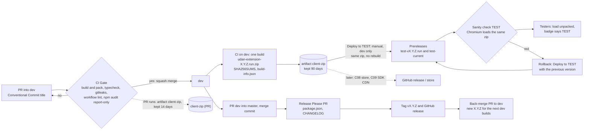

# Digital Assistant Client (UDAN)

Browser extension UI for the Universal Digital Assistant Network. The core logic comes from the published SDK, `@udan/digital-assistant-sdk` (source: https://github.com/Digital-Assistant/Digital-Assistant-SDK), so no local SDK checkout is needed.

## Integrating a site and required settings

The SDK needs `realm`, `clientId` and `clientSecret` for the customer. There are no defaults: without them the SDK sends no request and logs which keys are missing. Host page setup (script tags, `UDAAuthDataConfig`, `UDAPluginSDK`, the `UDASdkReady` rule) is in the SDK's [`USAGE.md`](https://github.com/Digital-Assistant/Digital-Assistant-SDK/blob/main/USAGE.md), with a runnable [`sample/index.html`](https://github.com/Digital-Assistant/Digital-Assistant-SDK/blob/main/sample/index.html).

## Build

```
npm install
npm run build        # default build -> build/
npm run build:dev    # development
npm run build:prod   # production -> dist/ (local build folder, not committed)
npm run build:qa     # QA -> dist/
```

`npm start` runs webpack in watch mode.

## Environment settings

The build reads public settings from `environments/<build>.env`: `local.env` for `npm run build`, `development.env`, `production.env` for `npm run build:prod`, `qa.env`. Copy `environments/env.example` (the schema, tracked) to that name and fill in the values; the copies are gitignored. Only the keys in `env.example` are inlined (webpack `DefinePlugin`, rules in `scripts/build-env.js`); an environment variable with the key's name overrides the file.

| Keys | What |
|---|---|
| `baseProdURL`, `baseTestURL` | Backend REST base, including `/api` |
| `tokenProdUrl`, `tokenTestUrl` | Token service |
| `llmProdUrl`, `llmTestUrl` | LLM search |
| `keycloakProdUrl`, `keycloakTestUrl` | Keycloak base URL |
| `keycloakRealm`, `keycloakClientId` | Keycloak realm and public client id |
| `googleAnalyticsMeasurementId`, `enableGoogleAnalytics` | Google Analytics |

Each URL has a PROD and a TEST value, so one build serves both; the environment is chosen at runtime (next section). The values are exposed as `src/config/buildConfig.ts` and handed to the SDK at start-up. The two Google Analytics keys are carried there but nothing reads them yet.

**No secrets.** Everything in these files ends up in the extension, which anyone can unzip. `scripts/ci/check-env-keys.sh` fails the release build if a secret key (`keycloakClientSecret`, `profanityKey`, `googleTranslateApiKey`, `googleAnalyticsSecretKey`, `clientSecret`) has a value or is referenced in `src/`.

Older env files: rename `keyCloakUrl` to `keycloakProdUrl` / `keycloakTestUrl`, split `tokenUrl` and `llmUrl` into the `Prod`/`Test` pairs, and delete the secret keys. `baseURL`, `profanity*` and `googleTranslate*` are no longer read.

## TEST or PROD at runtime

One zip serves both backends. The extension decides when it starts, first match wins:

| Order | Source | Notes |
|---|---|---|
| 1 | The host page: `window.UDAPluginSDK({ environment: 'TEST' })` | Only for pages that talk to the extension; call it after `UDASdkReady` (below) |
| 2 | The options page override (`chrome.storage.local`, key `udanEnvironment`) | Extension options: Automatic, TEST or PROD; a change applies within seconds, no reload of the extension |
| 3 | Install type: an **unpacked** install (`chrome.management.getSelf().installType === 'development'`) is TEST, any other install is PROD | Needs no extra permission; background service worker only |
| 4 | Default: PROD | Same as the SDK |

The URLs for the chosen environment come, per key, from the page (`apiBaseUrl`, `tokenUrl`, `llmUrl`, `keycloakUrl`), then from the build settings above, then from the SDK's own defaults. A key the page set is never overwritten. When the environment (or a backend, realm or client setting) changes while the panel is open, the panel drops the stored session of the old backend, asks the worker for the session again and runs the search again; no page reload is needed. This is `AuthContext` listening to `UDAConfigUpdated`. The Client never calls `authManager.init` (sign-in is the Chrome identity flow in the worker), so there is nothing else to re-run.

- **TEST badge.** When the extension runs against TEST, the panel header and the login screen show a `TEST` badge and the toolbar icon shows `TEST`. No badge means PROD.
- **`UDASdkReady`.** After the extension has applied the environment it fires a `window` event `UDASdkReady` with `detail: { environment: 'TEST' | 'PROD', source: 'page' | 'override' | 'install-type' | 'default' }` and sets `window.UDASdkIsReady = true` (for pages that attach late). A host page must call `UDAAuthDataConfig` and `UDAPluginSDK` only after it: earlier calls reach a copy of the SDK that is replaced later and are lost. Guide: SDK `USAGE.md`.
- **Manifest.** The runtime choice added `action` (toolbar badge) and `options_ui`; no new permission.
- **Rule of thumb for testers.** Unpacked build from `test-current` = TEST. A build installed from the Chrome Web Store (later) = PROD. Whether the store default should be PROD is the owner's decision (R1 in the CI/CD track); the rule above is what the code does today.

## Installing in Chrome (unpacked)

1. Get a zip. Testers: the newest TEST build is on the [`test-current`](../../releases/tag/test-current) prerelease (every build also has its own `test-v<version>` prerelease). Developers: the `client-zip` artifact of a CI run, or `scripts/ci/package-extension.sh` locally (`out/udan-extension-<version>.zip`). Unzip it into a new folder. A plain `npm run build:prod` also works: use `dist/`.
2. Open `chrome://extensions`, turn on **Developer mode**, click **Load unpacked** and pick the folder.
3. The card shows the version, for example `1.1.0 (abc1234)` (the `version_name`); **Details** shows the full `1.1.0.<run>`.

Unpacked extensions do not update themselves: remove the old one and load the new folder.

### Developers: build and load your own copy

```
npm install
cp environments/env.example environments/production.env   # fill in public values; see "Environment settings"
npm run build:prod                                        # -> dist/
```

Then load `dist/` unpacked as above, or run `scripts/ci/package-extension.sh` to get the same zip CI makes. A plain `npm run build` writes to `build/` and `npm start` rebuilds on change; reload the extension on `chrome://extensions` after each rebuild. There is no unit-test suite in this repo (the old Jest tests tested code that now lives in the SDK, which has its own); the check is the CI build, the type check and the sanity check below. `build:prod` and `build:qa` drop `console.*` calls (terser `drop_console`); `build` and `build:dev` keep them.


## Sign-in and where the config lives

- **Login path.** The real login is the Chrome identity flow in the background worker (`LoginWithBrowser`, uses `chrome.identity`). The panel's Sign-in button sends the page event `RequestUDASessionData`; the worker answers with the session, or starts `LoginWithBrowser` when no signed-in identity exists. There is deliberately **no Keycloak `check-sso` on page load** (removed on purpose; the original extension never had it): opening a page makes zero Keycloak requests. Do not add one back.
- **Config reaches the worker only through the build.** The worker (`Background.ts`) reads `src/config/buildConfig.ts`, which comes from the env settings above. A host page calling `UDAPluginSDK({...})` only changes the page world, not the worker, so realm and URLs cannot be set from a site. The host-page copy of the SDK (`src/Headers.js`) carries its own SDK build.
- **Backend CORS.** The extension calls the backend from a `chrome-extension://` origin, and customer sites from their own origins. The backend must allow those origins (with credentials) and the request headers `Content-Type`, `Authorization`, `X-Requested-With`, `x-sdk-client` and `udan-realm`; otherwise the browser reports a CORS failure and the sanity check prints "TEST backend CORS". See the Server README, "CORS".

## Testing a change locally

The CI sanity check is unauthenticated. To exercise the whole flow against a local backend (no secrets in the repo, no committed flags):

1. Start the backend (Server `README`, "Run locally") and note its `/api` URL and the realm/client id the SDK must use.
2. Build the SDK you want to test (`npm pack` in the SDK repo, see its `RELEASE_PROCESS.md`) and install the tarball without touching `package.json`: `npm install --no-save <sdk>.tgz`. A later `npm ci` reinstalls the pinned npm version, so install the tarball again after it. Check with `npm ls @udan/digital-assistant-sdk`.
3. `npm run build:dev` with a local env file, then load `build/` unpacked (`chrome://extensions`).
4. For automation use Playwright Chromium with the extension loaded in a persistent profile (`scripts/ci/smoke-extension.mjs` is the pattern) and stub `chrome.identity.getProfileUserInfo` in the service worker, so the Google sign-in needs no real account.
5. The SDK needs `realm`, `clientId` and `clientSecret`; supply the secret only in your own untracked local build and never share or upload that build (everything in it is readable by whoever unzips it).

Behaviour checklist (all 14 pass on `dev` with the current SDK against a local backend). `npm run e2e:behaviour` runs it, see the next section.

| # | Check |
|---|---|
| 1 | Extension loads, worker starts |
| 2 | Content script injects, panel mounts (`#udan-react-root`, shadow root) |
| 3 | Panel opens, login screen shown |
| 4 | No console errors on load |
| 5 | Backend reached with the build's own defaults |
| 6 | Early host-page `UDAPluginSDK({environment, realm})` honoured (page world; the worker takes the build config) |
| 7 | Zero Keycloak requests on page load |
| 8 | Login: `getsessionkey` 200, `checkauthid` 200, token service `POST /user/token` 201, `checkusersession` 200, with the `UDAN-Realm` header |
| 9 | Search list `GET /api/search/all` 200; a text filter shows a saved recording |
| 10 | Record two clicks; steps listed |
| 11 | Save: `clickednode` x2 200, `recordsequencedata` 200 |
| 12 | Saved recording listed and searchable |
| 13 | Playback navigates the steps, `userclick` 204, ends on "Playback completed" |
| 14 | No failed backend calls in the whole run |

## Behaviour check (local stack)

`scripts/e2e/behaviour-check.mjs` runs the 14 checks above without a person: Chromium (pinned `playwright-core`, new headless mode) loads an unpacked build, opens `scripts/ci/fixtures/host-page.html` from a local server, signs in, records the two buttons, saves, searches and plays the recording.

```
npm run build                        # local.env -> build/ (the backend URLs of your local stack)
npm run e2e:behaviour -- --build <dir> --backend http://localhost:<port>/api [--auth chrome-identity] [--identity <label>] [--out <dir>] [--headed]
```

- **The build must be able to sign in.** The SDK needs `realm`, `clientId` and `clientSecret`, and this repo never holds the secret, so a plain `build/` stops at check 5 ("worker SDK not configured"). Pass a copy that your own local tooling completed, keep it out of the repo and delete it after the run. The runner reads no secret and prints none.
- **Auth drivers** (`--auth`): `chrome-identity` (default) replaces `chrome.identity.getProfileUserInfo` in the running worker with a stub. It answers "not signed in" while the page loads (check 3), then a labelled test identity (`<label>@example.test`, default label `pk-e2e-a`) when the runner clicks "Sign in with UDAN". The build is not patched. `keycloak-pkce` is a placeholder for the PKCE sign-in and exits 2 until it is implemented (the `authDrivers` object in the script).
- **Data:** each run saves a new recording named `pk e2e <label> <run id>` on a fresh host-page port (the SDK scopes recordings by host and port), so reruns stay green. The data stays in the local backend.
- **Output** in `--out` (default `out/behaviour/<run id>/`, gitignored): `behaviour-check.json` (checks plus every backend, token-service and Keycloak call: method, path, status, `UDAN-Realm` yes/no) and `behaviour-check.md` (check, result, evidence), plus `failure.png` when a check fails. Hosts are shown as `<backend>`, `<token service>`, `<keycloak>`; tokens and bodies are never recorded.
- **Exit codes:** 0 all 14 pass, 1 a check failed, 2 usage or setup error, 3 backend unreachable (checked before the browser starts).
- Not in CI: it needs the Server, the token service and Keycloak. The first run on a machine needs `npx playwright-core install chromium`.

## CI and releases

Branch from `dev` and open a PR into `dev`; the PR title must be a [Conventional Commit](https://www.conventionalcommits.org/) (`feat: ...`, `fix: ...`) because it becomes the squash commit and drives the changelog.

**Build once.** Every CI run builds the extension once and packs it into one zip, the extension's equivalent of an image digest. Testers and later the store get exactly that zip, never a rebuild. Scripts and details: `scripts/ci/README.md`.

- Zip: `udan-extension-<X.Y.Z.N>.zip`, plus `SHA256SUMS` and `build-info.json` (commit, branch, run, SDK version and integrity, names of the env keys that were set). Same commit and run number give the same bytes.
- Version: CI stamps the built manifest with `version = X.Y.Z.<run number>` and `version_name = "X.Y.Z (<short commit>)"`. X.Y.Z comes from `package.json` (Release Please owns it); the run number makes each build unique and higher than the last. The source manifests only hold the base version, for local builds.
- Retention: artifact `client-zip`, 90 days for pushes to `dev`, 14 days for PRs. The run summary shows the version, SHA256 and SDK version.
- Build settings in CI come from GitHub Actions **variables** (`BASE_PROD_URL`, `TOKEN_TEST_URL`, ...: `scripts/ci/generate-env.sh --print-names`), never from secrets. They are set once at the organization level and shared with the SDK repo, which uses the same names.


Release Please no longer touches the manifests: CI owns the extension version. Attaching the zip to production releases and the store upload come in later steps; until then the store upload stays manual. `dist/` is no longer committed: it is only the local `build:prod` folder.

**Deploy to TEST.** Testers get builds from GitHub prereleases, never from a rebuild. Run the workflow `Deploy to TEST` on `dev` (Actions tab, or `gh workflow run deploy-test.yml --ref dev`). With no input it takes the newest `dev` build; `-f version=X.Y.Z.N` (from a CI run summary) takes that one, which is also the rollback. It verifies `SHA256SUMS`, the version and that the commit is on `dev`, then publishes prerelease `test-v<version>` and moves `test-current` to it. Neither is ever marked latest. The notes say whether the build talks to the TEST backend and list known issues (`scripts/ci/test-known-issues.md`). The workflow refuses any other branch. A build is deployable while its artifact lives (90 days). After publishing, job `Sanity check TEST` loads that same zip into Chromium (Playwright) and checks that the extension starts, the panel mounts and the TEST backend answers; it is read-only and skips the backend checks for builds that call no backend. A failure turns the run red but does not unpublish; redeploy the previous version to roll back. Details and the laptop command: `scripts/ci/README.md`.

**Roll back TEST.** Run `Deploy to TEST` on `dev` with `version` set to the previous build (for example `1.1.0.11`; the version is in the earlier prerelease's name and in each CI run summary). `test-current` moves back to that build, the sanity job runs again, and testers reinstall from `test-current`. It works while that build's CI artifact is still kept (90 days). In the release notes of a rollback the "changes since" link compares newer to older and reads as empty; ignore it.

**Bumping the SDK.** The Client pins `@udan/digital-assistant-sdk` to an exact version (`package.json` and lockfile). To try a new SDK: PR with the new pin into `dev`, wait for the build, run `Deploy to TEST`, test. Only after that passes does the SDK maintainer move npm `latest` (SDK `RELEASE_PROCESS.md`, "Promotion and rollback"). The SDK version of every build is in `build-info.json` and in the release notes.

**Sanity check.** The `Sanity check TEST` job runs `scripts/ci/smoke-extension.sh` (details in `scripts/ci/README.md`); you can run it on a laptop with the same zip.

`webpack` is pinned to 5.112.2 (exact, like the other build tools). 5.112.0 once failed on the SDK bundle; 5.112.2 builds it and passes the extension smoke check (retried 2026-10-28).
