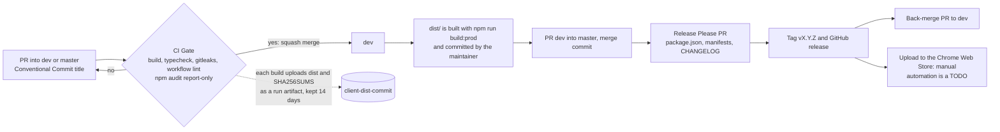

# Digital Assistant Client (UDAN)

Browser extension UI for the Universal Digital Assistant Network. The core logic comes from the published SDK, `@udan/digital-assistant-sdk` (source: https://github.com/Digital-Assistant/Digital-Assistant-SDK), so no local SDK checkout is needed.

## Build

```
npm install
npm run build        # default build -> build/
npm run build:dev    # development
npm run build:prod   # production -> dist/
npm run build:qa     # QA -> dist/
```

`npm start` runs webpack in watch mode.

## CI and releases

Branch from `dev` and open a PR into `dev`; the PR title must be a [Conventional Commit](https://www.conventionalcommits.org/) (`feat: ...`, `fix: ...`) because it becomes the squash commit and drives the changelog. The extension has no server deploy: a release is a tagged version plus a manual store upload.

Release Please does not rebuild `dist/`: build and commit it before the release PR.

`webpack` is pinned to 5.105.4: 5.112.0 fails on the SDK bundle.
