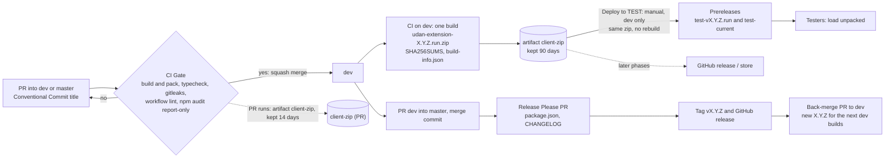

# Digital Assistant Client (UDAN)

Browser extension UI for the Universal Digital Assistant Network. The core logic comes from the published SDK, `@udan/digital-assistant-sdk` (source: https://github.com/Digital-Assistant/Digital-Assistant-SDK), so no local SDK checkout is needed.

## Integrating a site and required settings

The SDK needs `realm`, `clientId` and `clientSecret` for the customer. There are no defaults: without them the SDK sends no request and logs which keys are missing. Host page setup (script tags, `UDAAuthDataConfig`, `UDAPluginSDK`, the `UDASdkReady` rule) is in the SDK's [`USAGE.md`](https://github.com/Digital-Assistant/Digital-Assistant-SDK/blob/main/USAGE.md), with a runnable [`sample/index.html`](https://github.com/Digital-Assistant/Digital-Assistant-SDK/blob/main/sample/index.html).

## Build

```
npm install
npm run build        # default build -> build/
npm run build:dev    # development
npm run build:prod   # production -> dist/ (local build folder, not committed)
npm run build:qa     # QA -> dist/
```

`npm start` runs webpack in watch mode.

## Environment settings

The build reads public settings from `environments/<build>.env`: `local.env` for `npm run build`, `development.env`, `production.env` for `npm run build:prod`, `qa.env`. Copy `environments/env.example` (the schema, tracked) to that name and fill in the values; the copies are gitignored. Only the keys in `env.example` are inlined (webpack `DefinePlugin`, rules in `scripts/build-env.js`); an environment variable with the key's name overrides the file.

| Keys | What |
|---|---|
| `baseProdURL`, `baseTestURL` | Backend REST base, including `/api` |
| `tokenProdUrl`, `tokenTestUrl` | Token service |
| `llmProdUrl`, `llmTestUrl` | LLM search |
| `keycloakProdUrl`, `keycloakTestUrl` | Keycloak base URL |
| `keycloakRealm`, `keycloakClientId` | Keycloak realm and public client id |
| `googleAnalyticsMeasurementId`, `enableGoogleAnalytics` | Google Analytics |

Each URL has a PROD and a TEST value, so one build can serve both; the environment is chosen at runtime. The values are exposed as `src/config/buildConfig.ts` (not used by the app yet).

**No secrets.** Everything in these files ends up in the extension, which anyone can unzip. `scripts/ci/check-env-keys.sh` fails the release build if a secret key (`keycloakClientSecret`, `profanityKey`, `googleTranslateApiKey`, `googleAnalyticsSecretKey`, `clientSecret`) has a value or is referenced in `src/`.

Older env files: rename `keyCloakUrl` to `keycloakProdUrl` / `keycloakTestUrl`, split `tokenUrl` and `llmUrl` into the `Prod`/`Test` pairs, and delete the secret keys. `baseURL`, `profanity*` and `googleTranslate*` are no longer read.

## Installing in Chrome (unpacked)

1. Get a zip. Testers: the newest TEST build is on the [`test-current`](../../releases/tag/test-current) prerelease (every build also has its own `test-v<version>` prerelease). Developers: the `client-zip` artifact of a CI run, or `scripts/ci/package-extension.sh` locally (`out/udan-extension-<version>.zip`). Unzip it into a new folder. A plain `npm run build:prod` also works: use `dist/`.
2. Open `chrome://extensions`, turn on **Developer mode**, click **Load unpacked** and pick the folder.
3. The card shows the version, for example `1.1.0 (abc1234)` (the `version_name`); **Details** shows the full `1.1.0.<run>`.

Unpacked extensions do not update themselves: remove the old one and load the new folder.

## CI and releases

Branch from `dev` and open a PR into `dev`; the PR title must be a [Conventional Commit](https://www.conventionalcommits.org/) (`feat: ...`, `fix: ...`) because it becomes the squash commit and drives the changelog.

**Build once.** Every CI run builds the extension once and packs it into one zip, the extension's equivalent of an image digest. Testers and later the store get exactly that zip, never a rebuild. Scripts and details: `scripts/ci/README.md`.

- Zip: `udan-extension-<X.Y.Z.N>.zip`, plus `SHA256SUMS` and `build-info.json` (commit, branch, run, SDK version and integrity, names of the env keys that were set). Same commit and run number give the same bytes.
- Version: CI stamps the built manifest with `version = X.Y.Z.<run number>` and `version_name = "X.Y.Z (<short commit>)"`. X.Y.Z comes from `package.json` (Release Please owns it); the run number makes each build unique and higher than the last. The source manifests only hold the base version, for local builds.
- Retention: artifact `client-zip`, 90 days for pushes to `dev`, 14 days for PRs. The run summary shows the version, SHA256 and SDK version.
- Build settings in CI come from GitHub Actions **variables** (`BASE_PROD_URL`, `TOKEN_TEST_URL`, ...: `scripts/ci/generate-env.sh --print-names`), never from secrets. They are set once at the organization level and shared with the SDK repo, which uses the same names.


Release Please no longer touches the manifests: CI owns the extension version. Attaching the zip to production releases and the store upload come in later steps; until then the store upload stays manual. `dist/` is no longer committed: it is only the local `build:prod` folder.

**Deploy to TEST.** Testers get builds from GitHub prereleases, never from a rebuild. Run the workflow `Deploy to TEST` on `dev` (Actions tab, or `gh workflow run deploy-test.yml --ref dev`). With no input it takes the newest `dev` build; `-f version=X.Y.Z.N` (from a CI run summary) takes that one, which is also the rollback. It verifies `SHA256SUMS`, the version and that the commit is on `dev`, then publishes prerelease `test-v<version>` and moves `test-current` to it. Neither is ever marked latest. The notes say whether the build talks to the TEST backend and list known issues (`scripts/ci/test-known-issues.md`). The workflow refuses any other branch. A build is deployable while its artifact lives (90 days). After publishing, job `Sanity check TEST` loads that same zip into Chromium (Playwright) and checks that the extension starts, the panel mounts and the TEST backend answers; it is read-only and skips the backend checks for builds that call no backend. A failure turns the run red but does not unpublish; redeploy the previous version to roll back. Details and the laptop command: `scripts/ci/README.md`.

`webpack` is pinned to 5.105.4: 5.112.0 fails on the SDK bundle.
