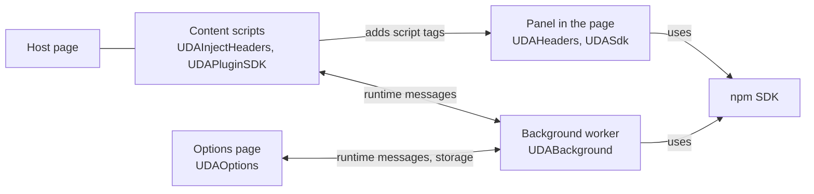

# Architecture overview

This repository is the Chrome extension (Manifest V3) of the Universal Digital Assistant Network. It holds the
panel UI, the content scripts and the background worker. The core logic comes from the published npm package
`@udan/digital-assistant-sdk`, pinned to an exact version in [`package.json`](../../package.json). This page is the
map. [`README.md`](../../README.md) and [`AGENTS.md`](../../AGENTS.md) hold the details.

## Components and entry points

`webpack.config.js` builds seven entries into `assets/` of the output folder (`build/` or `dist/`).
`public/` is copied to the output root, so `manifest.json` and `options.html` sit beside `assets/`.

| Bundle | Source | Role |
| --- | --- | --- |
| `UDAInjectHeaders` | `src/InjectHeaders.js` | Content script at `document_start`. Adds a script tag for `UDAHeaders.js` to the page |
| `UDAHeaders` | `src/Headers.js` | Runs in the page. Starts click tracking early, through `src/util/headers/clickTracking.js` |
| `UDAPluginSDK` | `src/ExtensionSDK.js` | Content script at `document_end`. Checks browser and screen size, adds a script tag for `UDASdk.js`, and passes messages between the page and the background worker |
| `UDASdk` | `src/main.tsx` | Runs in the page. Mounts the React panel (`src/App.tsx`) in a shadow root once the TEST or PROD choice is known |
| `UDABackground` | `src/Background.ts` | Service worker. Sign-in, session, and the environment choice |
| `UDAOptions` | `src/Options.ts` | Script of the options page `public/options.html` |
| `UDALoad` | `src/InjectSDK.js` | Not in the manifest. Loads `src/AuthService.ts` and `src/main.tsx` directly |

The content scripts, the background worker and the options page are declared in
[`public/manifest.json`](../../public/manifest.json). Changes to it need the owner's approval
([`AGENTS.md`](../../AGENTS.md), "Environment settings").

## Sign-in

Sign-in runs in the background worker. `src/browser-auth/LoginWithKeycloak.ts` does authorization code with PKCE.
`src/browser-auth/LoginWithBrowser.ts` is the older Chrome identity path. `src/AuthService.ts` is loaded by
`src/InjectSDK.js`; it answers the SDK's session requests with the SDK's own helpers. The rules and the choice
between the paths are in [`README.md`](../../README.md), "Sign-in and where the config lives".

## TEST or PROD at runtime

One build serves both environments. `src/config/runtimeEnvironment.ts` holds the rules, and `src/config/tierStamp.ts`
reads the `tier.json` stamp of a store install. The options page stores an override in `chrome.storage.local`.
The precedence is in [`README.md`](../../README.md), "TEST or PROD at runtime".

## Build configuration

Public build-time keys come from `environments/<build>.env`. The key list is `environments/env.example`.
`scripts/build-env.js` reads both, and `webpack.config.js` inlines the values with `DefinePlugin`.
`src/config/buildConfig.ts` exposes them to the code. Secret keys stay empty:
`scripts/ci/check-env-keys.sh` fails the build otherwise.

## The SDK dependency

The extension imports the SDK from npm. There is no local link to an SDK checkout. The SDK holds the core logic;
this repository supplies the browser parts: the content scripts, the worker and the panel UI.

