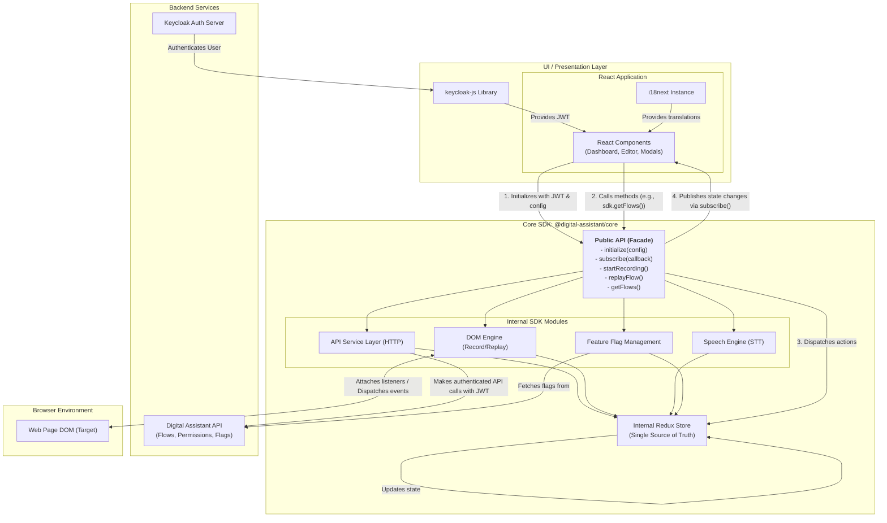

### **Digital Assistant - Decoupled SDK Architecture**

This diagram shows how different UI applications (React, Angular, etc.) consume the `@digital-assistant/core` SDK, which handles all the business logic and interacts with the browser environment.

---

### **Key Architectural Flows**

These flows describe the step-by-step sequence of events for the primary operations of the application, referencing the components defined in the architecture diagram.

#### **Flow 1: Application Initialization & Authentication**

This is the startup sequence that occurs when a user first loads the application.

1.  **User Authentication:** The user accesses the application. The **React Application** detects that the user is not authenticated and uses the **`keycloak-js` Library** to redirect them to the **Keycloak Auth Server**.
2.  **Token Acquisition:** After a successful login, the **Keycloak Auth Server** redirects the user back to the application. The **`keycloak-js` Library** securely captures the user's JWT (JSON Web Token).
3.  **SDK Initialization:** The main **React Application** component now has the JWT. It initializes the core library by calling the `initialize({ jwt: '...' })` method on the **Core SDK's Public API**.
4.  **SDK Configuration:** The **Core SDK** stores the JWT internally. This token will be used by the **API Service Layer** to authenticate all future requests to the backend. The SDK is now ready for use.

#### **Flow 2: Fetching Data (e.g., User's Flows)**

This describes the standard unidirectional data flow for reading information from the backend.

1.  **User Action:** A user navigates to a page, which triggers a **React Component** (e.g., `Dashboard`) to mount.
2.  **API Call via SDK:** The component's `useEffect` hook calls a method on the **Public API**, such as `sdk.getFlows()`, to request the data it needs.
3.  **Backend Request:** The **Core SDK** delegates this call to its internal **API Service Layer**. This module constructs an HTTP request, attaches the stored JWT to the headers for authentication, and sends it to the **Digital Assistant API**.
4.  **State Update:** The **API Service Layer** receives the response from the backend. It then dispatches an action with the data as a payload to the internal **Redux Store** (e.g., `flows/fetchSuccess`).
5.  **UI Notification:** The **Redux Store** updates its state. The **Core SDK**'s subscription system automatically notifies all listeners (including the React UI) of this state change.
6.  **UI Re-render:** The **React Application**, listening via its subscription callback, receives the new state. React's state management hooks (like `useState` or a custom hook for the SDK) trigger a re-render of the relevant components, displaying the fetched flows to the user.

#### **Flow 3: Recording a New Flow**

This flow shows how the SDK interacts with the browser environment to capture user actions.

1.  **Initiate Recording:** The user clicks a "Record" button within the **React UI**. This triggers a call to the `sdk.startRecording()` method on the **Public API**.
2.  **State Change:** The SDK dispatches an action to its **Redux Store** to update the application state (e.g., `isRecording: true`). This change is published to the UI, which might update to show a "recording in progress" indicator.
3.  **DOM Interaction:** The **DOM Engine** module within the SDK is activated. It attaches event listeners directly to the target **Web Page DOM** to capture user interactions like clicks, keyboard input, etc.
4.  **Save Events:** As each interaction occurs, the **DOM Engine** captures, serializes, and dispatches actions to the **Redux Store** to add the event to the current session's data.
5.  **Persist Flow:** When the user stops recording (triggering `sdk.stopRecording()`), the SDK uses the **API Service Layer** to send the complete, serialized session data to the **Digital Assistant API** for persistence.

#### **Flow 4: Replaying an Existing Flow**

This flow is the reverse of recording, demonstrating how the SDK can drive the browser.

1.  **Initiate Replay:** The user selects a saved flow in the **React UI** and clicks "Replay". This calls the `sdk.replayFlow(flowData)` method on the **Public API**.
2.  **State Change:** The SDK updates its internal state in the **Redux Store** to `isReplaying: true`, and the UI is updated via the subscription.
3.  **DOM Interaction:** The **DOM Engine** takes the `flowData` object, which contains the list of recorded events.
4.  **Simulate Events:** The engine iterates through the events in sequence, programmatically dispatching them onto the **Web Page DOM**. This precisely simulates the original user's clicks, typing, and other actions.
5.  **Completion:** Once all events have been replayed, the **DOM Engine** dispatches a final action to set `isReplaying: false`. The SDK publishes a `replayFinished` event, allowing the **React UI** to notify the user that the process is complete.

---

### Architectural Differences: Tightly-Coupled vs. Decoupled

Here is a side-by-side comparison of the key architectural differences:

| Characteristic | Original Architecture (Tightly-Coupled) | Refactored Architecture (Decoupled SDK) |
| :--- | :--- | :--- |
| **Coupling** | **Tightly Coupled.** Business logic (recording, replay) is interwoven with state management (Redux Thunks) and the view layer (React). | **Loosely Coupled.** Business logic is completely isolated in a framework-agnostic package. The UI is just one of many possible consumers. |
| **Location of Logic** | Inside Redux Thunks/Slices, which are part of the React application's structure. | Inside the `@digital-assistant/core` SDK, as pure TypeScript modules. |
| **Communication** | Components dispatch Redux actions. The logic is an internal implementation detail of the app's state. | The UI calls public methods on a clear API (`sdk.start()`). The SDK communicates back via events or callbacks. |
| **Reusability** | **Low.** The core logic cannot be used outside of this specific React + Redux application without a major rewrite. | **High.** The SDK can be published to NPM and installed in **any** JavaScript project (React, Angular, Vue, vanilla JS). |
| **Testability** | **Difficult.** Unit testing the business logic requires mocking the Redux store and potentially a browser DOM environment. Tests are complex and brittle. | **Simple & Robust.** The SDK's core logic can be unit-tested in isolation using a simple test runner (like Jest) in a Node.js environment. |
| **Maintainability** | **Challenging.** A bug in the recording logic could be located in a component, an action, or a thunk. Changes can have unexpected side effects on the UI. | **Simplified.** It's easy to isolate issues: Is it a bug in the UI's presentation, or is it a bug in the SDK's core logic? |
| **Customer Flexibility**| **Very Low.** Customers must use the provided React UI. Customization is limited to what you expose and is difficult to implement. | **Very High.** This is the primary benefit. Customers can build a completely bespoke UI from scratch, tailored to their brand and needs. |

---

### The Pros: Highlighting the Benefits of Separation

Separating the core functionality isn't just a technical exercise; it delivers significant business and development value.

#### 1. **True Portability and Reusability (The Core Business Value)**
This is the most significant advantage. By creating the `@digital-assistant/core` SDK, you are no longer selling a "React plugin"; you are selling a **core technology**. Any customer with a web application, regardless of their tech stack, can now integrate your functionality. This dramatically expands your potential market and directly addresses the feedback you've received.

#### 2. **Enhanced Testability and System Reliability**
When logic is isolated, it can be tested exhaustively with pure unit tests. You can simulate hundreds of scenarios without ever needing to render a UI component. This leads to:
*   **Higher Code Coverage:** It's easier to test every edge case in the business logic.
*   **More Robust Code:** A thoroughly tested core means fewer bugs in the fundamental operations of recording and replaying.
*   **Increased Confidence:** Developers can make changes to the core SDK with confidence, knowing that a comprehensive test suite will catch any regressions.

#### 3. **Improved Developer Velocity and Scalability**
A decoupled architecture allows your teams to work more efficiently and independently.
*   **Parallel Workstreams:** Your "UI Team" can focus on building the best possible React application, experimenting with new designs and user experiences. Simultaneously, your "Core Team" can focus on improving the engine—enhancing recording accuracy, adding new features, or optimizing performance. They don't block each other.
*   **Simplified Onboarding:** A new developer working on the UI doesn't need to understand the complex inner workings of the replay engine. They only need to learn the public API of the SDK—a much smaller and simpler surface area.

#### 4. **Simplified Maintenance and Debugging**
When a bug is reported, the first question is immediately clear: "Is the problem in the UI or the SDK?"
*   **Isolate the Problem:** You can test the SDK in isolation. If the SDK works correctly on its own, the bug must be in the UI's implementation. If the SDK fails, you know the bug is in the core logic.
*   **Clear Ownership:** This separation of concerns leads to clear code ownership, making maintenance far more efficient.

#### 5. **Future-Proofing Your Technology**
Frontend frameworks come and go. By isolating your core business logic into a framework-agnostic library, you have future-proofed your most valuable asset. If a new framework like Svelte or SolidJS becomes dominant in five years, you don't need to rewrite your core technology. You simply create a new UI application that consumes the exact same, stable SDK.