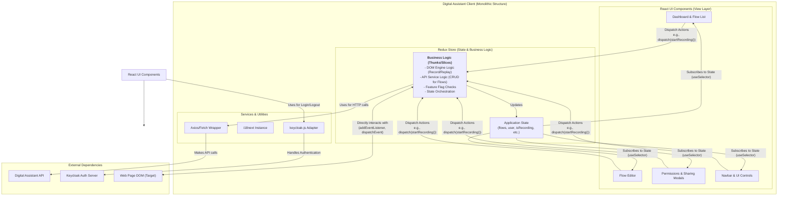

### **Original Codebase Architecture (As-Is)**

The diagram below illustrates how the business logic, state management, and UI rendering are all interwoven within a single React application.

### **Architectural Analysis**

This diagram reveals a classic "smart" or "container" component pattern heavily reliant on Redux.

*   **Tightly Coupled Logic and State:** This is the most critical characteristic. The core business logic—how to record, how to replay, how to save a flow—is implemented directly within Redux Thunks (or a similar middleware like Sagas). This means the application's business logic is inherently tied to its state management library (Redux) and, by extension, to the React framework.
*   **Redux as the Application Core:** Redux is not just a state container; it's the central hub for orchestrating all major operations. API calls and DOM manipulations are initiated from and managed by Redux Thunks.
*   **Smart Components:** The React components are "smart." They contain minimal presentational logic and are primarily responsible for dispatching Redux actions and subscribing to state changes via hooks like `useDispatch` and `useSelector`.
*   **Direct DOM Interaction from Logic Layer:** The modules responsible for business logic (the Thunks) directly reach out and manipulate the external "Web Page DOM." This makes the logic difficult to test without a full browser environment and impossible to run in a different context (like on a server or in another framework).

### **Architectural Flow: Recording a Flow (Original Version)**

Let's trace the same flow we discussed for the new architecture to see the difference.

1.  **User Action:** A user clicks the "Record" button in a **React Component** (e.g., `Navbar`).
2.  **Dispatch Action:** The component's `onClick` handler calls `dispatch(startRecordingThunk())`. It does not contain any recording logic itself.
3.  **Business Logic Execution:** The `startRecordingThunk` is executed by the Redux middleware. Inside this thunk:
    *   It first dispatches a synchronous action to update the **Redux State**: `{ type: 'recording/start', payload: ... }`.
    *   The **React Components** subscribed to this piece of state re-render to show a "recording" indicator.
    *   Crucially, the thunk then directly accesses the **Web Page DOM** using `document.addEventListener(...)` to set up the necessary listeners for capturing user clicks.
4.  **Event Capture:** When the user clicks on the target page, the listener (defined within the Redux logic) fires. This listener function then dispatches *another* Redux action, `dispatch(eventCapturedThunk(eventData))`, to save the captured event into the Redux store.
5.  **Cycle Repeats:** This cycle continues, with browser events being captured by listeners that are managed and defined within the Redux layer.

This analysis clearly highlights *why* we are undertaking this refactoring. The current architecture, while functional, locks the valuable business logic inside a specific framework's ecosystem (React + Redux), preventing its reuse and making it difficult for customers to build their own UIs without rebuilding everything.