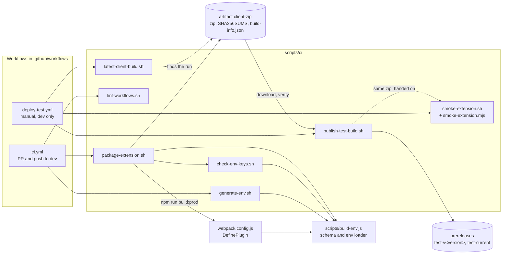

# CI scripts

Small bash scripts that build, check and package the extension. The GitHub workflows only call these scripts, so you can run the same steps on your laptop. Run them from anywhere: they move to the repo root themselves. You need Node 22, `zip`, and for the lint script `curl`, `python3` (with `venv`) and `shellcheck`.

Which workflow calls which script:


| Script | Called by | What it does |
|---|---|---|
| `generate-env.sh` | `ci.yml` job `build` | Writes `environments/production.env` (or `--build NAME`) from environment variables. Each key of `environments/env.example` is read from its UPPER_SNAKE name (`baseProdURL` from `BASE_PROD_URL`). In CI those are Actions **variables** (organization level, shared with the SDK repo), never secrets. Refuses to overwrite a local file unless `--force` (or `CI=true`). `--print-names` lists the variable names. |
| `check-env-keys.sh` | `package-extension.sh` | Fails if the env file is missing a schema key or gives a secret key a value, if `src/` reads a `process.env.<name>` outside the schema (`NODE_ENV` is fine), or if `src/` names a secret key (`keycloakClientSecret`, `profanityKey`, `googleTranslateApiKey`, `googleAnalyticsSecretKey`, `clientSecret`). Prints key names, never values. |
| `package-extension.sh` | `ci.yml` job `build` | Runs the env check, a clean `npm run build:prod`, stamps the **built** `dist/manifest.json` (`version` = `X.Y.Z.<run number>`, `version_name` = `X.Y.Z (<sha7>)`, X.Y.Z from `package.json`), writes `dist/build-info.json`, then `out/udan-extension-<version>.zip` (deterministic), `out/build-info.json` and `out/SHA256SUMS`. Options: `--run-number N`, `--sha SHA`, `--no-build`. |
| `latest-client-build.sh [VERSION]` | `deploy-test.yml` job `choose` | Prints `<run id> <version>` of the `dev` CI run holding that build, or of the newest `dev` build when no version is given. The version's last part is the run number; X.Y.Z is checked against `package.json` at the run's commit. Clear errors for an unknown version, a run without the artifact, or an expired artifact (90 days). No download. |
| `publish-test-build.sh DIR` | `deploy-test.yml` job `publish` | Takes a downloaded `client-zip` (never builds): checks `SHA256SUMS`, the zip name and the manifest inside it against `build-info.json`, and that the commit is on `dev`; then creates or updates prerelease `test-v<version>` and moves prerelease `test-current` to the same commit with the same files. Never marks either latest. The "changes" compare link is always older...newer; on a rollback (this commit behind `test-current`) the heading says so and the order is swapped. Writes the notes (install steps, backend state, `test-known-issues.md`) and the run summary. `DRY_RUN=1` runs every check and writes `DIR/RELEASE_NOTES.md` without changing a release. |
| `test-known-issues.md` | `publish-test-build.sh` | The "Known issues" list in the TEST release notes. Edit it on `dev`; the next deploy uses it. |
| `smoke-extension.sh ZIP BASE_TEST_URL` | `deploy-test.yml` job `Sanity check TEST` | Checks `SHA256SUMS` next to the zip, then runs `smoke-extension.mjs`: unpacks the zip, loads it in Chromium with the pinned `playwright-core` (new headless mode, persistent profile) and opens `fixtures/host-page.html` from a local server. Checks, 3 tries each: (1) the service worker starts and its manifest version equals `build-info.json`; (2) `#udan-react-root` mounts; (3) the SDK needs `realm`, `clientId` and `clientSecret` and sends nothing without them, and the build carries no client secret, so the script first sets obvious placeholders (`smoke-realm`, `smoke-client`, `smoke-placeholder`, only for keys still empty) on the worker's `UDAGlobalConfig` and asks the worker for the session again; then a request to `BASE_TEST_URL` gets a 2xx or 401 that is not the HTML fallback, and none goes to `BASE_PROD_URL` (a 403 prints "TEST backend CORS (DESIGN F9)"); (4) toolbar badge `TEST` and `UDASdkReady` fired. Checks 3 and 4 are **skipped** for builds without the runtime environment (no `UDASdkReady` in the bundle; those builds call no backend). Skips are not failures; any FAIL exits 1. Results go to stdout and `GITHUB_STEP_SUMMARY`. The test host is never printed (`<test backend>`). Unauthenticated, read-only. Check 3 proves a configured SDK reaches the backend, not that sign-in works. |
| `fixtures/host-page.html` | `smoke-extension.mjs`, `../e2e/behaviour-check.mjs` | Plain page the extension runs on (replaces the old `sample/index.html`, which loaded the SDK and Bootstrap from public CDNs). Two buttons to record. With `?udaEnvironment=...&udaRealm=...` in the URL it calls `UDAPluginSDK` after `UDASdkReady` (behaviour check 6); without them it calls nothing. |
| `lint-workflows.sh` | `ci.yml` job `workflow-lint` | actionlint (pinned, checksum-checked) and zizmor (pinned, offline) over `.github/workflows/*.yml`, shellcheck over `scripts/ci/*.sh`, `node --check` over `scripts/ci/*.mjs` and `scripts/e2e/*.mjs`. |

`scripts/build-env.js` (not a CI script) holds the env rules used by webpack and these scripts: the schema is `environments/env.example`, values come from `environments/<build>.env` (or the file named by `UDAN_ENV_FILE`), and an environment variable with the key's own name overrides the file.

## The zip
- One zip per CI run. Same commit, same run number and same env give the same bytes: entries are sorted, every timestamp is the commit time, file modes are fixed, and `zip -X -D` drops extra attributes.
- `build-info.json` (inside the zip and next to it): version, version_name, commit, branch, run id/number/attempt, `source_date_utc` (the commit time; the run id tells when it was built), SDK version + `integrity` from `package-lock.json`, Node version, and the **names** of the env keys that had a value.
- Artifact `client-zip`: kept 90 days for pushes to `dev`, 14 days for PRs. The run summary shows the version, SHA256 and SDK version.
- Firefox is not in use, so there is no Firefox zip (TODO). `manifest-firefox.json` is still copied into `dist/` but unused.

Try it locally with a throwaway env file (public placeholder values only):
```
BASE_PROD_URL=https://prod.example.invalid scripts/ci/generate-env.sh --build ci-local
UDAN_ENV_FILE=environments/ci-local.env scripts/ci/package-extension.sh --run-number 1
sha256sum out/*.zip
```

Try the publish checks without touching releases (needs `gh` logged in):
```
GITHUB_REPOSITORY=<owner>/<repo> scripts/ci/latest-client-build.sh          # newest dev build
gh run download <run id> -n client-zip -D /tmp/client-zip
GITHUB_REPOSITORY=<owner>/<repo> DRY_RUN=1 scripts/ci/publish-test-build.sh /tmp/client-zip
```

Try the sanity check on a laptop (after `npm ci`; the first run needs `npx playwright-core install chromium`). Use a zip built with your TEST URL, or the one from a dev CI run:
```
gh run download <run id> -n client-zip -D /tmp/client-zip
scripts/ci/smoke-extension.sh /tmp/client-zip/udan-extension-*.zip "$BASE_TEST_URL"   # BASE_PROD_URL optional
```
A wrong host fails check 3 with "no request reached <test backend>/api/".

No script contains a secret. Never put one in these files or in a variable that a workflow maps.

The 14-check behaviour run against a local stack (`scripts/e2e/behaviour-check.mjs`, `npm run e2e:behaviour`) is not a CI script: it needs a running backend. See the main README, "Behaviour check (local stack)".
