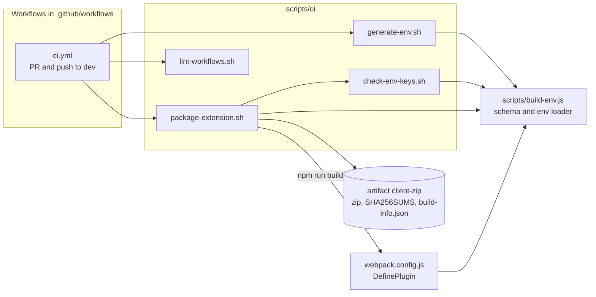

# CI scripts

Small bash scripts that build, check and package the extension. The GitHub workflows only call these scripts, so you can run the same steps on your laptop. Run them from anywhere: they move to the repo root themselves. You need Node 22, `zip`, and for the lint script `curl`, `python3` (with `venv`) and `shellcheck`.

Which workflow calls which script:


| Script | Called by | What it does |
|---|---|---|
| `generate-env.sh` | `ci.yml` job `build` | Writes `environments/production.env` (or `--build NAME`) from environment variables. Each key of `environments/env.example` is read from its UPPER_SNAKE name (`baseProdURL` from `BASE_PROD_URL`). In CI those are repository **variables**, never secrets. Refuses to overwrite a local file unless `--force` (or `CI=true`). `--print-names` lists the variable names. |
| `check-env-keys.sh` | `package-extension.sh` | Fails if the env file is missing a schema key or gives a secret key a value, if `src/` reads a `process.env.<name>` outside the schema (`NODE_ENV` is fine), or if `src/` names a secret key (`keycloakClientSecret`, `profanityKey`, `googleTranslateApiKey`, `googleAnalyticsSecretKey`, `clientSecret`). Prints key names, never values. |
| `package-extension.sh` | `ci.yml` job `build` | Runs the env check, a clean `npm run build:prod`, stamps the **built** `dist/manifest.json` (`version` = `X.Y.Z.<run number>`, `version_name` = `X.Y.Z (<sha7>)`, X.Y.Z from `package.json`), writes `dist/build-info.json`, then `out/udan-extension-<version>.zip` (deterministic), `out/build-info.json` and `out/SHA256SUMS`. Options: `--run-number N`, `--sha SHA`, `--no-build`. |
| `lint-workflows.sh` | `ci.yml` job `workflow-lint` | actionlint (pinned, checksum-checked) and zizmor (pinned, offline) over `.github/workflows/*.yml`, shellcheck over `scripts/ci/*.sh`. |

`scripts/build-env.js` (not a CI script) holds the env rules used by webpack and these scripts: the schema is `environments/env.example`, values come from `environments/<build>.env` (or the file named by `UDAN_ENV_FILE`), and an environment variable with the key's own name overrides the file.

## The zip
- One zip per CI run. Same commit, same run number and same env give the same bytes: entries are sorted, every timestamp is the commit time, file modes are fixed, and `zip -X -D` drops extra attributes.
- `build-info.json` (inside the zip and next to it): version, version_name, commit, branch, run id/number/attempt, `source_date_utc` (the commit time; the run id tells when it was built), SDK version + `integrity` from `package-lock.json`, Node version, and the **names** of the env keys that had a value.
- Artifact `client-zip`: kept 90 days for pushes to `dev`, 14 days for PRs. The run summary shows the version, SHA256 and SDK version.
- Firefox is not in use, so there is no Firefox zip (TODO). `manifest-firefox.json` is still copied into `dist/` but unused.

Try it locally with a throwaway env file (public placeholder values only):
```
BASE_PROD_URL=https://prod.example.invalid scripts/ci/generate-env.sh --build ci-local
UDAN_ENV_FILE=environments/ci-local.env scripts/ci/package-extension.sh --run-number 1
sha256sum out/*.zip
```

No script contains a secret. Never put one in these files or in a repository variable that `ci.yml` maps.
