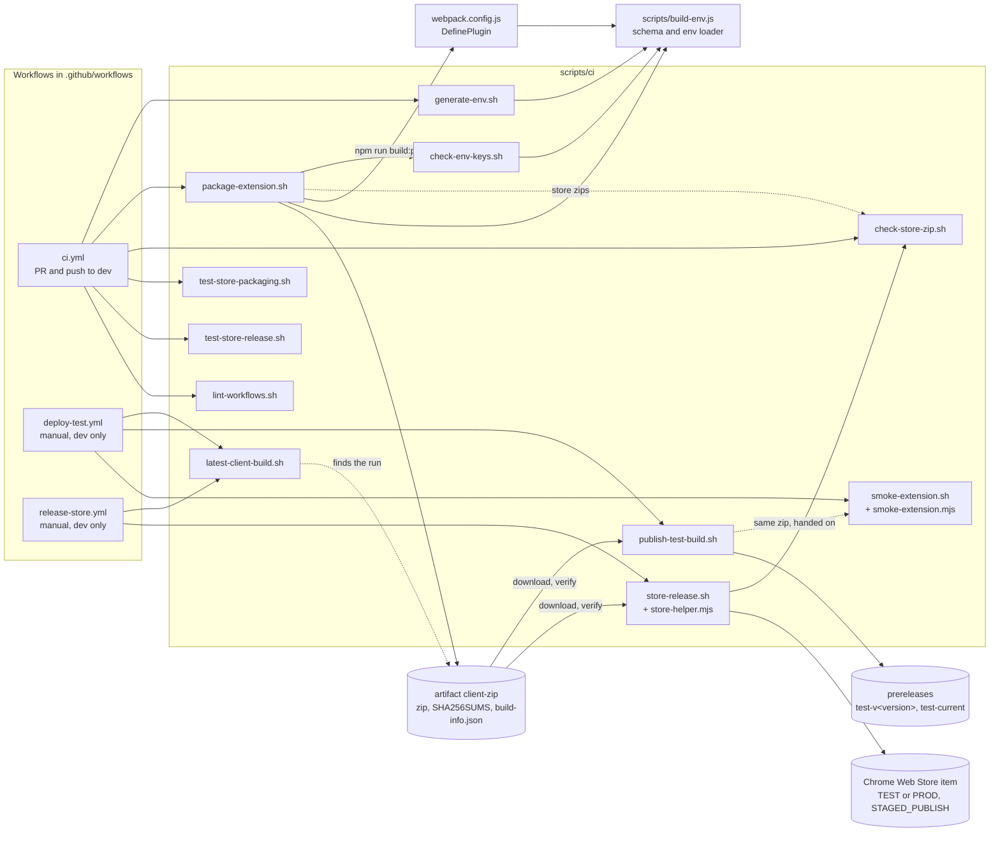

# CI scripts

Small bash scripts that build, check and package the extension. The GitHub workflows only call these scripts, so you can run the same steps on your laptop. Run them from anywhere: they move to the repo root themselves. You need Node 22, `zip`, and for the lint script `curl`, `python3` (with `venv`) and `shellcheck`.

Which workflow calls which script:


| Script | Called by | What it does |
|---|---|---|
| `generate-env.sh` | `ci.yml` job `build` | Writes `environments/production.env` (or `--build NAME`) from environment variables. Each key of `environments/env.example` is read from its UPPER_SNAKE name (`baseProdURL` from `BASE_PROD_URL`). In CI those are Actions **variables** (organization level, shared with the SDK repo), never secrets. Refuses to overwrite a local file unless `--force` (or `CI=true`). `--print-names` lists the variable names. |
| `check-env-keys.sh` | `package-extension.sh` | Fails if the env file is missing a schema key or gives a secret key a value, if `src/` reads a `process.env.<name>` outside the schema (`NODE_ENV` is fine), or if `src/` names a secret key (`keycloakClientSecret`, `profanityKey`, `googleTranslateApiKey`, `googleAnalyticsSecretKey`, `clientSecret`). Prints key names, never values. |
| `package-extension.sh` | `ci.yml` job `build` | Runs the env check, a clean `npm run build:prod`, stamps the **built** `dist/manifest.json` (`version` = `X.Y.Z.<run number>`, `version_name` = `X.Y.Z (<sha7>) run <run number>.<attempt> cfg <config hash>`, X.Y.Z from `package.json`; the attempt is `GITHUB_RUN_ATTEMPT`, default 1; the config hash is `node scripts/build-env.js <build> --hash`), writes `dist/build-info.json`, then `out/udan-extension-<version>.zip` (deterministic), `out/build-info.json` and `out/SHA256SUMS`. Options: `--run-number N`, `--sha SHA`, `--no-build`, `--store`, `--dist-dir DIR` and `--out-dir DIR` (the last two only with `--no-build`, for tests on a fixture). With `--store` it also writes `udan-extension-<version>-store-test.zip` and `-store-prod.zip` from the same `dist/` (see "The store zips") and adds their lines to `SHA256SUMS`. |
| `check-store-zip.sh [--require-keys k1,k2] ZIP [ZIP2]` | `ci.yml` job `build` | Checks a store zip (no manifest `key`, versions, `tier.json`, name, secret key names, baked-key booleans, `SHA256SUMS` line) and, given a TEST and a PROD zip, that every file except the allowed ones is byte-identical. Prints pass/FAIL, booleans and hashes only. Exit 1 on any failure. |
| `store-release.sh --tier test\|prod --version X.Y.Z.N --dir DIR [--dry-run] [--replace-pending]` | `release-store.yml` jobs `check` (always `--dry-run`) and `release` | Takes a downloaded `client-zip` (never builds) and releases one store zip to one Chrome Web Store item (see "Store release"). Every guard runs before any store write; the dry run reads no credential and calls no store API. `--status-file`, `--test-status-file` and `--test-record-file` (dry run only) check saved `fetchStatus` JSON or a saved TEST release record offline. Prints booleans, versions, states and hashes; never a token, a key or the TEST item id. Writes `DIR/store-release-record.json`. |
| `store-helper.mjs extension-id\|assertion` | `store-release.sh` | `extension-id`: the id Chrome derives from a public key on stdin (manifest `key`, or the store's `publicKey`). `assertion`: reads the service account key JSON on stdin and prints the signed JWT bearer assertion (scope `chromewebstore`, 10 minutes). No network; the key never touches a file or an argument. |
| `test-store-release.sh` | `ci.yml` job `typecheck` | Packs a fixture build, puts stub `gh`, `curl` and `aws` on `PATH`, and runs `store-release.sh`: dry runs of both tiers, one refusal per guard, the real-run path (token exchange, `fetchStatus`, `cancelSubmission`, upload, polling, `STAGED_PUBLISH`) against the stubs, and checks that no secret-like value reaches the output. Also the read-only `--status` mode: accepted, refused for `PENDING_REVIEW` and for `STAGED`, taken down, a bad token, and that the call log holds no write call. The "service account key" is a throw-away RSA key made by the test. No network, no store call. |
| `test-store-packaging.sh` | `ci.yml` job `typecheck` | Runs `package-extension.sh --store` and `check-store-zip.sh` on a small fixture `dist/` with public placeholder settings, then breaks a zip in a dozen ways (key, wrong stamp, missing stamp, name, version, secret names and values, a changed or extra file in the pair) and expects each to be refused. No build, no network. |
| `latest-client-build.sh [VERSION]` | `deploy-test.yml` job `choose` | Prints `<run id> <version>` of the `dev` CI run holding that build, or of the newest `dev` build when no version is given. The version's last part is the run number; X.Y.Z is checked against `package.json` at the run's commit. Clear errors for an unknown version, a run without the artifact, or an expired artifact (90 days). No download. |
| `publish-test-build.sh DIR` | `deploy-test.yml` job `publish` | Takes a downloaded `client-zip` (never builds): checks `SHA256SUMS`, the zip name and the manifest inside it against `build-info.json`, and that the commit is on `dev`; then creates or updates prerelease `test-v<version>` and moves prerelease `test-current` to the same commit with the same files. Never marks either latest. The "changes" compare link is always older...newer; on a rollback (this commit behind `test-current`) the heading says so and the order is swapped. Checks that `version_name` is derivable from `build-info.json` (builds from before the config hash are exempt, so rollbacks still work). Writes the notes (build identity first, and whether it differs from the build `test-current` held; then install steps, backend state, `test-known-issues.md`) and the run summary. `DRY_RUN=1` runs every check and writes `DIR/RELEASE_NOTES.md` without changing a release. |
| `test-known-issues.md` | `publish-test-build.sh` | The "Known issues" list in the TEST release notes. Edit it on `dev`; the next deploy uses it. |
| `smoke-extension.sh ZIP BASE_TEST_URL` | `deploy-test.yml` job `Sanity check TEST` | Checks `SHA256SUMS` next to the zip, then runs `smoke-extension.mjs`: unpacks the zip, loads it in Chromium with the pinned `playwright-core` (new headless mode, persistent profile) and opens `fixtures/host-page.html` from a local server. Checks, 3 tries each: (1) the service worker starts and its manifest version equals `build-info.json`; (2) `#udan-react-root` mounts; (3) the SDK needs `realm`, `clientId` and `clientSecret` and sends nothing without them, and the build carries no client secret, so the script first sets obvious placeholders (`smoke-realm`, `smoke-client`, `smoke-placeholder`, only for keys still empty) on the worker's `UDAGlobalConfig` and asks the worker for the session again; then a request to `BASE_TEST_URL` gets a 2xx or 401 that is not the HTML fallback, and none goes to `BASE_PROD_URL` (a 403 prints "TEST backend CORS (DESIGN F9)"); (4) toolbar badge `TEST` and `UDASdkReady` fired. Checks 3 and 4 are **skipped** for builds without the runtime environment (no `UDASdkReady` in the bundle; those builds call no backend). Skips are not failures; any FAIL exits 1. Results go to stdout and `GITHUB_STEP_SUMMARY`. The test host is never printed (`<test backend>`). Unauthenticated, read-only. Check 3 proves a configured SDK reaches the backend, not that sign-in works. |
| `fixtures/host-page.html` | `smoke-extension.mjs`, `../e2e/behaviour-check.mjs` | Plain page the extension runs on (replaces the old `sample/index.html`, which loaded the SDK and Bootstrap from public CDNs). Two buttons to record. With `?udaEnvironment=...&udaRealm=...` in the URL it calls `UDAPluginSDK` after `UDASdkReady` (behaviour check 6); without them it calls nothing. |
| `lint-workflows.sh` | `ci.yml` job `workflow-lint` | actionlint (pinned, checksum-checked) and zizmor (pinned, offline) over `.github/workflows/*.yml`, shellcheck over `scripts/ci/*.sh`, `node --check` over `scripts/ci/*.mjs` and `scripts/e2e/*.mjs`. |

`scripts/build-env.js` (not a CI script) holds the env rules used by webpack and these scripts: the schema is `environments/env.example`, values come from `environments/<build>.env` (or the file named by `UDAN_ENV_FILE`), and an environment variable with the key's own name overrides the file.

## The store zips
`package-extension.sh --store` (always used by CI) cuts, from the same already stamped `dist/`, `udan-extension-<version>-store-test.zip` and `udan-extension-<version>-store-prod.zip`. Both drop the manifest `key` and carry `tier.json` (`{"tier":"TEST"}` or `{"tier":"PROD"}`). They differ only in `manifest.json` `name` (TEST: `UDA TEST`), `tier.json`, a `tier` field in `build-info.json` and the four TEST icon badges from `store/test-icons/`; all other files are byte-identical. Both zips keep the single `config_hash` and have their own line in `SHA256SUMS`. The sideload zip is unchanged, and `publish-test-build.sh` and `deploy-test.yml` ignore the store zips (they publish only the sideload zip). Nothing here uploads to the store: `release-store.yml` does (next section).

## Store release
`release-store.yml` (`Release to Chrome Web Store`, manual, `dev` only) takes one store zip of an existing `dev` build and submits it to one store item with `publishType=STAGED_PUBLISH`: after Google's review the item is `STAGED` and the owner presses **Publish** in the dashboard (within 30 days). It never rebuilds.

| Input | Meaning |
|---|---|
| `tier` | `test`: the unlisted TEST item, environment `test-store` (no reviewers). `prod`: the PROD item `jejdickefnhgkhdcjjcmoiiljlkanpln`, environment `production` (two reviewers) |
| `version` | `X.Y.Z.N` of the `dev` build (CI run summary) |
| `dry_run` | default **true**: job `check` runs every build guard and stops. No environment, no credential, no store call |
| `replace_pending` | default false. At most one pending submission (`PENDING_REVIEW` or `STAGED`) per item; `true` cancels it first and loses its place in the review queue |
| `status_only` | default false. `true` runs only job `status`: read-only, no `version`, no artifact (next paragraph). Refused together with `dry_run=false` |

Guards (all before any store write; the full list is in the header of `store-release.sh`):
- **build:** `SHA256SUMS`; `build-info.json` version, full commit, branch `dev`; `check-store-zip.sh` on the pair with the keys the tier needs (`baseProdURL`, `keycloakProdUrl` or the TEST pair, plus `keycloakRealm`, `keycloakPublicClientId`); the stamp in the chosen zip equals the tier; the commit is on `dev`; both zips have the same **bundle hash** (sha256 over every file except the allowed differences; manifest and `build-info.json` without `name`/`tier`).
- **store** (`fetchStatus`, real run): not taken down; no upload in progress; version greater than every published and submitted version of the item; the one-pending rule; the id derived from the item's `publicKey` equals the item id (again after the upload).
- **promotion** (`tier=prod`): the newest successful real run titled `Store release test <version>` left a `store-release-record` with the same version, commit, `config_hash` and bundle hash, and the TEST zip in this artifact has the sha256 that run uploaded; the TEST item's `fetchStatus` shows the version `PUBLISHED` or `STAGED`. The smoke pass is the reviewer's approval of the `production` environment; nothing else is recorded. The dry run of `tier=prod` only warns when no TEST release exists yet; the real run refuses.

Real run (job `release`, `id-token: write`): the job's GitHub OIDC token assumes the AWS role `STORE_AWS_ROLE_ARN`; the service account key is read from Secrets Manager (`STORE_KEY_SECRET_ID`) straight into `store-helper.mjs assertion`, exchanged for an access token (masked), then `fetchStatus`, optional `cancelSubmission`, `:upload`, polling `fetchStatus` until `lastAsyncUploadState` is `SUCCEEDED`, `:publish` (`STAGED_PUBLISH`, `blockOnWarnings`), polling the submitted state. Artifact `store-release-record` (90 days; version, commit, hashes, states, the sha256 of the item id, never the id) is what a later `tier=prod` run checks.

**Status call (`status_only=true`, script `--status`).** Run it before cutting a release. Job `status` runs in the environment of the tier (`test-store`, or `production` and its reviewers for `tier=prod`) with `id-token: write`, does the token exchange and then **only** `GET :fetchStatus` for the item of the tier (for `tier=prod` also the TEST item, informational). `api()` in the script aborts with exit 70 on any other call in status mode, and `test-store-release.sh` checks the call log for writes. It prints a table (item `TEST`/`PROD`, never an id; submitted state; submitted and published versions; ACCEPTED, PENDING or REFUSED) and the highest version the item already has. Exit codes: `0` a new submission would be accepted; `3` a submission is pending (`PENDING_REVIEW` or `STAGED`), so a new one is refused unless `replace_pending=true`; `1` item taken down, upload in progress, publicKey does not match the item id, or the status could not be read; `2` usage. `--status` cannot be combined with `--version`, `--dir`, `--replace-pending`; with `--dry-run --status-file <json>` it reads no credential and evaluates a saved `fetchStatus` file (tests, laptops).

Variables (environment or repository, not secrets; names only): `CWS_PUBLISHER_ID`, `CWS_TEST_ITEM_ID`, `CWS_PROD_ITEM_ID`, `STORE_AWS_ROLE_ARN`, `STORE_KEY_SECRET_ID`, `AWS_REGION`. The key exists only in AWS Secrets Manager; the role must trust only this repository's environments `test-store` and `production`.

```
scripts/ci/store-release.sh --tier test --version X.Y.Z.N --dir <unzipped client-zip> --dry-run
scripts/ci/store-release.sh --status --dry-run --tier test --status-file <saved fetchStatus.json>
scripts/ci/test-store-release.sh          # offline tests with stubs
```
A real run is refused outside GitHub Actions.

## The zip
- One zip per CI run attempt. Same commit, run number, attempt and env give the same bytes: entries are sorted, every timestamp is the commit time, file modes are fixed, and `zip -X -D` drops extra attributes.
- `build-info.json` (inside the zip and next to it): version, version_name, commit, branch, run id/number/attempt, `config_hash`, `source_date_utc` (the commit time; the run id tells when it was built), SDK version + `integrity` from `package-lock.json`, Node version, and the **names** of the env keys that had a value.
- Artifact `client-zip`: kept 90 days for pushes to `dev`, 14 days for PRs. The run summary shows the version, SHA256 and SDK version.
- Firefox is not in use, so there is no Firefox zip (TODO). `manifest-firefox.json` is still copied into `dist/` but unused.

Try it locally with a throwaway env file (public placeholder values only):
```
BASE_PROD_URL=https://prod.example.invalid scripts/ci/generate-env.sh --build ci-local
UDAN_ENV_FILE=environments/ci-local.env scripts/ci/package-extension.sh --run-number 1
sha256sum out/*.zip
```

Try the publish checks without touching releases (needs `gh` logged in):
```
GITHUB_REPOSITORY=<owner>/<repo> scripts/ci/latest-client-build.sh          # newest dev build
gh run download <run id> -n client-zip -D /tmp/client-zip
GITHUB_REPOSITORY=<owner>/<repo> DRY_RUN=1 scripts/ci/publish-test-build.sh /tmp/client-zip
```

Try the sanity check on a laptop (after `npm ci`; the first run needs `npx playwright-core install chromium`). Use a zip built with your TEST URL, or the one from a dev CI run:
```
gh run download <run id> -n client-zip -D /tmp/client-zip
scripts/ci/smoke-extension.sh /tmp/client-zip/udan-extension-*.zip "$BASE_TEST_URL"   # BASE_PROD_URL optional
```
A wrong host fails check 3 with "no request reached <test backend>/api/".

No script contains a secret. Never put one in these files or in a variable that a workflow maps.

The 14-check behaviour run against a local stack (`scripts/e2e/behaviour-check.mjs`, `npm run e2e:behaviour`) is not a CI script: it needs a running backend. See the main README, "Behaviour check (local stack)".
